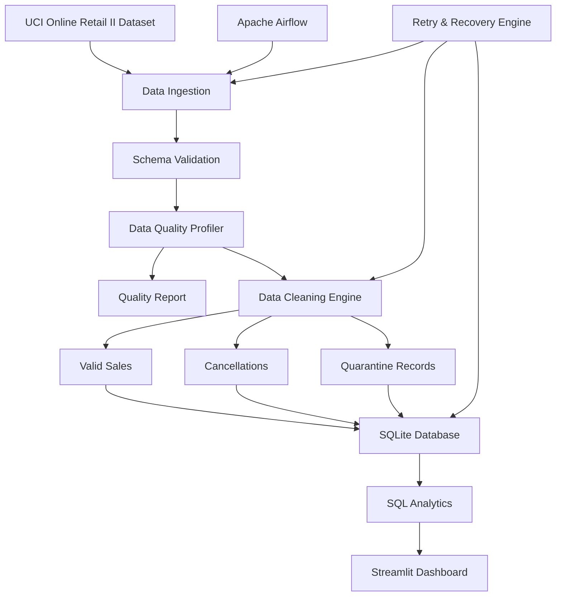

# 🛡️ Sentinel — Data Observability & Self-Healing Pipeline

**An end-to-end data engineering project that ingests, validates, cleans, monitors, stores and analyzes over one million retail transactions.**

Sentinel is a modular data observability platform built with Python, Pandas, SQL, SQLite, Apache Airflow and Streamlit.

It combines data quality profiling, automated data cleaning, quarantine management, retry-based failure recovery, SQL analytics and an interactive monitoring dashboard.

---

## 🚀 Project Overview

Real-world data pipelines encounter missing values, duplicate records, invalid transactions, inconsistent data and execution failures.

Sentinel addresses these problems through a structured pipeline that:

- Ingests large Excel datasets.
- Validates schemas and required columns.
- Profiles data completeness, uniqueness and validity.
- Detects duplicate and suspicious transaction records.
- Separates cancellations from suspicious records.
- Cleans and stores valid sales transactions.
- Maintains a SQLite analytics database.
- Orchestrates pipeline execution using Apache Airflow.
- Retries failed operations using exponential backoff.
- Displays business and data quality metrics through Streamlit.

## 🏗️ Architecture



## 🧰 Technology Stack

| Technology | Purpose |
|---|---|
| Python | Pipeline development |
| Pandas | Data processing and cleaning |
| SQL | Data analysis and aggregation |
| SQLite | Persistent analytical storage |
| Apache Airflow | Workflow orchestration |
| Streamlit | Interactive monitoring dashboard |
| Pytest | Automated testing |
| PyYAML | Configuration management |
| OpenPyXL | Excel ingestion |

## 📂 Project Structure

```text
Sentinel/
│
├── config/
│   └── settings.yaml
│
├── dags/
│   └── sentinel_pipeline.py
│
├── dashboard/
│   └── app.py
│
├── data/
│   ├── raw/
│   ├── processed/
│   ├── quarantine/
│   └── sentinel.db
│
├── reports/
│   ├── quality_report.json
│   ├── cleaning_summary.json
│   └── sentinel.log
│
├── scripts/
│
├── sql/
│   └── analytics.sql
│
├── src/
│   └── sentinel/
│       ├── ingestion/
│       │   └── loader.py
│       ├── processing/
│       │   └── cleaner.py
│       ├── quality/
│       │   └── profiler.py
│       ├── recovery/
│       │   └── retry.py
│       ├── storage/
│       │   ├── writer.py
│       │   ├── database.py
│       │   └── analytics.py
│       ├── config.py
│       └── pipeline.py
│
├── tests/
│   ├── test_ingestion.py
│   ├── test_quality.py
│   ├── test_cleaner.py
│   ├── test_storage.py
│   └── test_recovery.py
│
├── .gitignore
├── pytest.ini
├── requirements.txt
└── README.md
```

## ⚙️ Installation & Setup

### 1. Clone the repository

```bash
git clone https://github.com/AQUIB-AI/Sentinel.git
cd Sentinel
```

### 2. Create a virtual environment

```bash
python3 -m venv venv
source venv/bin/activate
```

### 3. Install dependencies

```bash
python -m pip install -r requirements.txt
```

### 4. Download the dataset

Download the Online Retail II workbook from:

https://archive.ics.uci.edu/dataset/502/online+retail+ii

Place the extracted Excel workbook at:

```text
data/raw/online_retail_II.xlsx
```

The original dataset is not included in this repository.

## ▶️ Running Sentinel

### Run the complete data pipeline

```bash
python -m src.sentinel.pipeline
```

### Run the data quality profiler

```bash
python -m src.sentinel.quality.profiler
```

### Run the database loader

```bash
python -m src.sentinel.storage.database
```

### Launch the Streamlit dashboard

```bash
streamlit run dashboard/app.py
```

Open the local URL printed by Streamlit, usually:

```text
http://localhost:8501
```

### Run automated tests

```bash
python -m pytest -v
```

## 🔍 Data Quality & Observability

Sentinel evaluates data using four weighted dimensions:

| Quality Dimension | Weight |
|---|---:|
| Completeness | 40% |
| Uniqueness | 20% |
| Validity | 30% |
| Schema compliance | 10% |

The profiler generates a structured JSON report containing missing-value counts, duplicate statistics, business rule violations and an overall quality score.

### Business rules

- Detect missing critical fields.
- Identify duplicate business records.
- Identify cancellation transactions.
- Flag suspicious negative quantities.
- Detect negative and zero prices.
- Validate transaction dates.
- Preserve records with missing customer identifiers as review flags rather than automatically discarding them.

## ♻️ Self-Healing & Recovery

Sentinel includes a reusable retry engine.

Features:

- Configurable maximum retry attempts.
- Exponential backoff.
- Selective exception handling.
- Structured failure logging.
- Successful recovery logging.
- Permanent failure reporting.

Default retry configuration:

```python
MAX_ATTEMPTS = 3
RETRY_DELAY = 2
BACKOFF_MULTIPLIER = 2
```

The retry engine can recover temporary failures without immediately terminating the pipeline.

## 📊 Dashboard Features

The Streamlit dashboard provides:

1. Business performance KPIs.
2. Revenue and monthly trends.
3. Top-selling products.
4. Country-level revenue analysis.
5. Customer analytics.
6. Cancellation monitoring.
7. Data quality score breakdown.
8. Quarantined record monitoring.
9. Pipeline execution summary.
10. Self-healing retry and recovery logs.

## 📈 Example Pipeline Results

Results from the current local execution:

| Metric | Result |
|---|---:|
| Input records | 1,067,371 |
| Duplicate records removed | 34,335 |
| Unique records after deduplication | 1,033,036 |
| Cancellation records | 19,103 |
| Quarantined records | 3,398 |
| Cleaned sales records | 1,010,535 |
| Overall data quality score | 98.42% |

*These are observed results from the current implementation and dataset run, not guaranteed values for every execution.*

## 🧪 Testing

Sentinel uses Pytest to validate individual components.

Test coverage includes:

- Excel ingestion and schema validation.
- Missing-value profiling.
- Duplicate detection.
- Cancellation classification.
- Suspicious transaction detection.
- Data cleaning and quarantine.
- SQLite output generation.
- Retry and recovery behaviour.

Run all tests:

```bash
python -m pytest -v
```

## 🔮 Future Improvements

- Real-time data quality alerting.
- Configurable data quality thresholds.
- Recovery event history in SQLite.
- Pipeline execution metrics and latency monitoring.
- Data drift detection.
- Incremental data ingestion.
- Docker-based deployment.
- Cloud deployment and monitoring.

## 📚 Dataset Attribution

**Dataset:** Online Retail II

**Creator:** Daqing Chen

**Source:** UCI Machine Learning Repository

**DOI:** https://doi.org/10.24432/C5CG6D

**License:** Creative Commons Attribution 4.0 International (CC BY 4.0)

Citation:

Chen, D. (2012). Online Retail II [Dataset]. UCI Machine Learning Repository.

https://doi.org/10.24432/C5CG6D

The dataset is used for educational and analytical purposes. Appropriate attribution is provided to the original creator.

## 👨‍💻 Author

**Aquib Alam Khan**

B.Tech — Computer Science & Engineering, NIT Durgapur

GitHub: https://github.com/AQUIB-AI

---

⭐ If you find this project useful, consider giving the repository a star.
